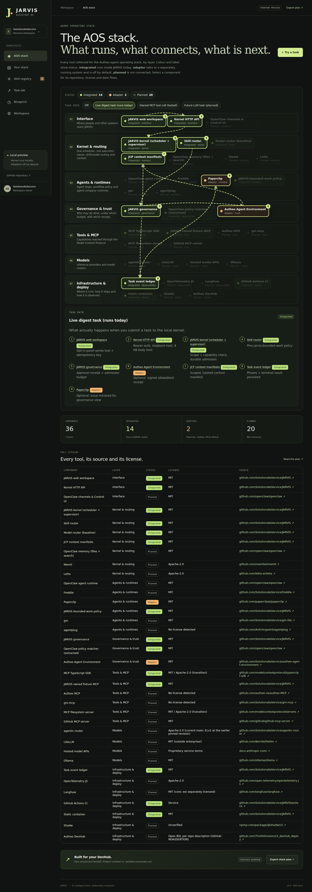

> **Implementation checkpoint — October 7, 2026:** Phase 1a now has a real consolidated local task kernel in `kernel/`, persistent SQLite tasks/events, one execution supervisor, bounded workflow/context routing, scoped authenticated HTTP and an opt-in frontend. This is not a full LLM agent runtime or complete merger. See [kernel implementation](docs/KERNEL.md). Earlier claims that no backend exists are superseded by this checkpoint.

# JARVIS

## The AOS stack

JARVIS is where the Autheo **agent operating stack (AOS)** is collected and consolidated. The landing view of the site is an interactive, layered map of that stack: every component is coloured **and labelled** by status, opens a detail drawer (repository, license, what is real vs planned, data flows), and three toggleable task paths draw how work moves through the layers.

| Layer | Integrated (runs in JARVIS, tested) | Adapter (off by default, external system runs separately) | Planned (not connected) |
|---|---|---|---|
| Interface | JARVIS web workspace, kernel HTTP API | | OpenClaw channels / Control UI |
| Kernel & routing | Kernel scheduler + supervisor, skill router, baseline model router, JCP context manifests | | OpenClaw memory, Mem0, Letta |
| Agents & runtimes | JARVIS bounded-work policy | **Paperclip** (REST governance mirror), **DADA** (pinned design skill, work packets) | OpenClaw agent runtime, Freddie, gm, agentplug |
| Governance & trust | JARVIS governance receipts/budgets, extracted OpenClaw policy matcher | **Autheo Agent Environment** (Ed25519 receipt format) | |
| Tools & MCP | MCP TypeScript SDK client, owned fixture MCP server | | Autheo MCP, gm-mcp, MCP filesystem, GitHub MCP |
| Models | | | agentic-router, LiteLLM, hosted model APIs, Ollama |
| Infrastructure & deploy | Task event ledger, GitHub Actions CI, static container | | OpenTelemetry, Langfuse, Shadw, Autheo DevHub |

The table is generated from one data file, [src/aos-stack.js](src/aos-stack.js) (schema: [schemas/aos-component.schema.json](schemas/aos-component.schema.json)), which the kernel also exports. Tests fail if an integrated or adapter entry points at code that does not exist, or if a planned entry claims real behaviour.

- **Paperclip adapter** ([kernel/adapters/paperclip.js](kernel/adapters/paperclip.js)): a client for a separately running Paperclip server's documented REST API (health, companies, agents, issues, comments, approvals, heartbeat runs). It mirrors JARVIS kernel tasks into Paperclip issues and reads a governance snapshot. JARVIS stays the only scheduler: it never checks out issues, and heartbeat invocation is refused unless a caller opts in per call. `npm run start:kernel` wires it when JARVIS_PAPERCLIP_ENABLED=1, JARVIS_PAPERCLIP_URL and JARVIS_PAPERCLIP_COMPANY_ID are set (see [kernel/startup.js](kernel/startup.js)). Tested against an in-process mock server, **not yet against a live Paperclip instance**.
- **Autheo trust adapter** ([kernel/adapters/autheo.js](kernel/adapters/autheo.js), [autheo-client.js](kernel/adapters/autheo-client.js)): implements the autheo-agent-environment **v1** signature/receipt-chain spec (0.2.0 at 68bfb55) in JS. All upstream v1 vectors pass (copied to test/fixtures/autheo-v1 with the source commit), and the vendored v1 JSON schemas validate bodies. Receipts from the earlier 0.1 format (8106edd) still verify and are labelled legacy-0.1. JARVIS governance outcomes become signed v1 receipts, plus outcome receipts for terminal tasks, when JARVIS_AUTHEO_ENABLED=1. An optional client for the loopback /v1 API (evaluate, outcomes, identities, mandates, ledger) is enabled by JARVIS_AUTHEO_API_ENABLED=1, with the token taken from env or a token file. It does not gate the kernel. With JARVIS_AUTHEO_PYTHON set, tests also cross-check against the upstream Python code and a live `serve` process. Receipts record simulated decisions only (executed: false).
- **DADA design skill** ([kernel/adapters/dada.js](kernel/adapters/dada.js)): [SolutionsAsService/dada](https://github.com/SolutionsAsService/dada) is a prompt-level agent skill for ambitious graphic design (identity, posters, editorial, type, UI and websites) that runs a critic-panel loop over an anchor graph. It is not a CLI, MCP server or library, and the JARVIS kernel has no inference, so JARVIS does not run the loop. JARVIS pins a commit in [upstreams/lock.json](upstreams/lock.json), fetches it on demand (`npm run upstream -- fetch dada`), checks its structural contract against [upstreams/contracts/dada.json](upstreams/contracts/dada.json), and with JARVIS_DADA_ENABLED=1 adds a `design.dada` task operation that returns a design work packet (pinned skill path + sha256, mode, required critic seats, stop conditions) for an agent runtime, plus a structural DESIGN-LOG.md check. The upstream has no LICENSE file, so nothing is copied. Keep it current with `npm run upstream:check` and `npm run upstream -- update dada` ([docs/UPSTREAMS.md](docs/UPSTREAMS.md)).

The Paperclip monorepo and the Python prototype are **not vendored**. Only the 12 Autheo v1 JSON schema files are vendored unchanged ([kernel/vendor/autheo](kernel/vendor/autheo), hash ledger included). Pinned revisions are in [docs/SOURCES.md](docs/SOURCES.md).

**One ubiquitous intelligent assistant — through codebase unification.** A SolutionsAsService project planning a single JARVIS monorepo/kernel that consolidates reusable OpenClaw and Freddie services, gm workflow policy, Paperclip governance, model routing and first-class MCP capabilities. The current release includes the Phase 0 frontend and a real Phase 1a bounded local kernel; the complete LLM agent-core/governance consolidation remains in progress.

## What ships today

A deployable, responsive **frontend foundation**, not a completed assistant backend:

- Six working views: the interactive AOS stack map (landing), stack planner, sample skill registry, local task lab, architecture blueprint and workspace settings.
- Capability overlap detection and reversible canonical-skill selection.
- Explicit MCP installation proposals and portable JSON plan export; **no software is installed**.
- A locally executable task state machine demonstrating terminal completion, bounded retries and action-time deadline checks. **No agents or subprocesses execute in the task lab.**
- Local browser persistence, keyboard-accessible dialogs, empty/error states and responsive layouts.
- Tests, CI, a static production build, and an actionable [implementation plan](docs/PLAN.md).

The registry is seeded sample data, not an inventory of installed skills. All engine connections and DevHub integration are clearly marked planned. The UI does not resolve server-side execution issues by itself.

## Run

Node **24.15+** (Node 24 LTS).

    npm ci
    npm run dev

Open the local URL printed by Vite. Build: npm run build. Serve output: npm run preview. Deploy the contents of **dist/**, not the source directory. Hash-based navigation and relative assets support a static host and subpaths.

[Deployment / Shadw](docs/DEPLOYMENT.md) · [Codebase unification plan](docs/PLAN.md) · [Proposed context/kernel contracts](docs/CONTRACTS.md) · [Pinned primary-source evidence](docs/SOURCES.md)

## Verify

    npm test
    npm run build
    # On a host where browser execution is permitted:
    npx playwright install chromium
    npm run test:browser

E2E tests exercise desktop/mobile navigation, the AOS stack drawer/flow lines/filters (and assert no external requests), duplicate resolution, persistence, plan export and task completion. Headless hosts without system Chromium libraries can point LD_LIBRARY_PATH at extracted libnss3/libnspr4/libasound2. Refresh the docs screenshots with npm run build and node scripts/capture-aos-stack.mjs. Running a build alone is not browser verification. Actual validation evidence belongs in [docs/VERIFICATION.md](docs/VERIFICATION.md).

## Safety and privacy

No model keys, GitHub tokens, MCP secrets or Gateway credentials belong in this frontend. Settings are descriptive and are not contacted. Browser storage contains sample task titles and nonsecret configuration; avoid entering private work in a publicly shared browser. Exported plans contain no credentials. No telemetry and no external UI assets or CDNs: fonts fall back to the local system stack.

The static preview does not scan/delete installed skills, run commands or modify Gateway configuration. The separately started local kernel exposes authenticated scoped APIs and executes bounded text hashing; its real MCP fixture runs only through explicitly configured programmatic tests, not automatic installation. External integrations require explicit authorization, and backend validation never trusts client-side checks.

## Existing solutions and boundaries

The end-state is **consolidated reusable code and in-process services**, not a permanent control plane over independent assistant runtimes. Proposed canonical owner: JARVIS kernel scheduler/execution supervisor, initially using an OpenClaw-derived reusable agent core. Select Freddie service/provider primitives without booting its second agent loop; extract Paperclip goals/work queues/approvals/cost governance without its parallel heartbeat dispatcher. gm remains bounded workflow policy. Compatibility shells are temporary migration aids, not the product.

Model routing (agentic-router-derived candidate) is distinct from capability-aware skill routing. Proposed JARVIS Context Protocol (JCP draft 0.1) is a tentative internal contract, **not an existing standard or replacement for MCP**. MCP servers retain their standard protocols and gain first-class catalog, auth, permissions, lifecycle and approval-backed installation planning. No automatic installation is assumed.

**Implementation underway:** the repository now contains one local task kernel and an actual OpenClaw policy-code extraction. Full agent loops, Freddie services, Paperclip domain/accounting migration and external MCP installation remain future gates. No host runtime/service/config installation was performed. DevHub and public backend deployment contracts remain unknown; static sample views remain disconnected unless local kernel mode is explicitly enabled.

No upstream engines or skills are vendored or relicensed in this first release. Their names, copyright and trademarks remain their owners’ property. Original JARVIS code is MIT; future imported modules retain their own licenses/notices. In particular, the inspected agentic-router source is **Elastic License 2.0, not MIT**; code/artifact reuse and hosted deployment require a separate license decision. See the source matrix and incremental acceptance gates before implementation.
